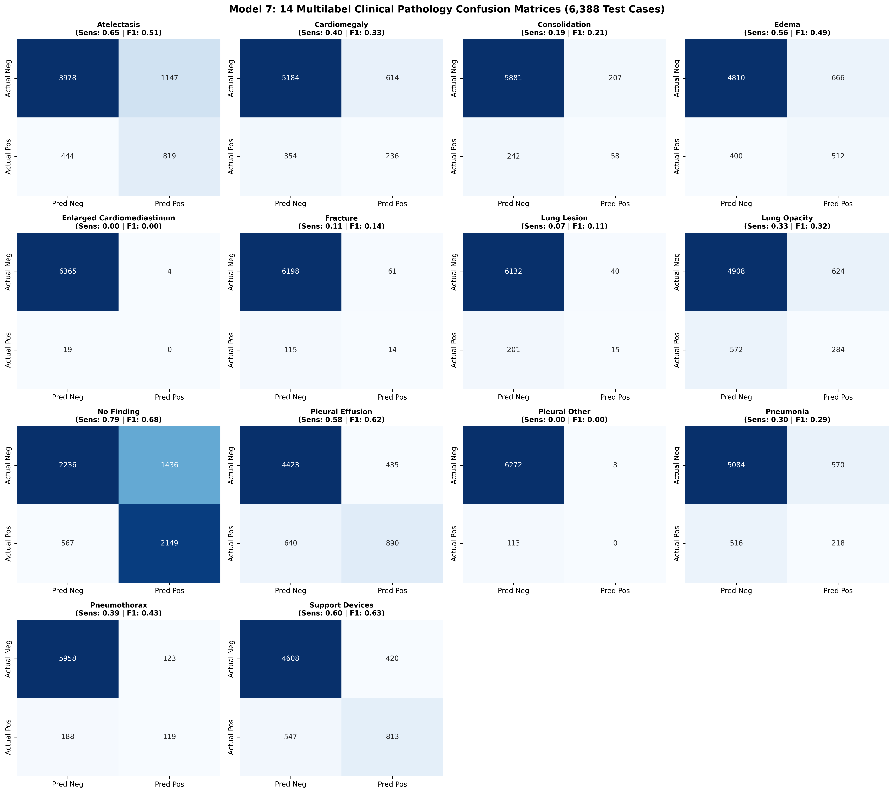
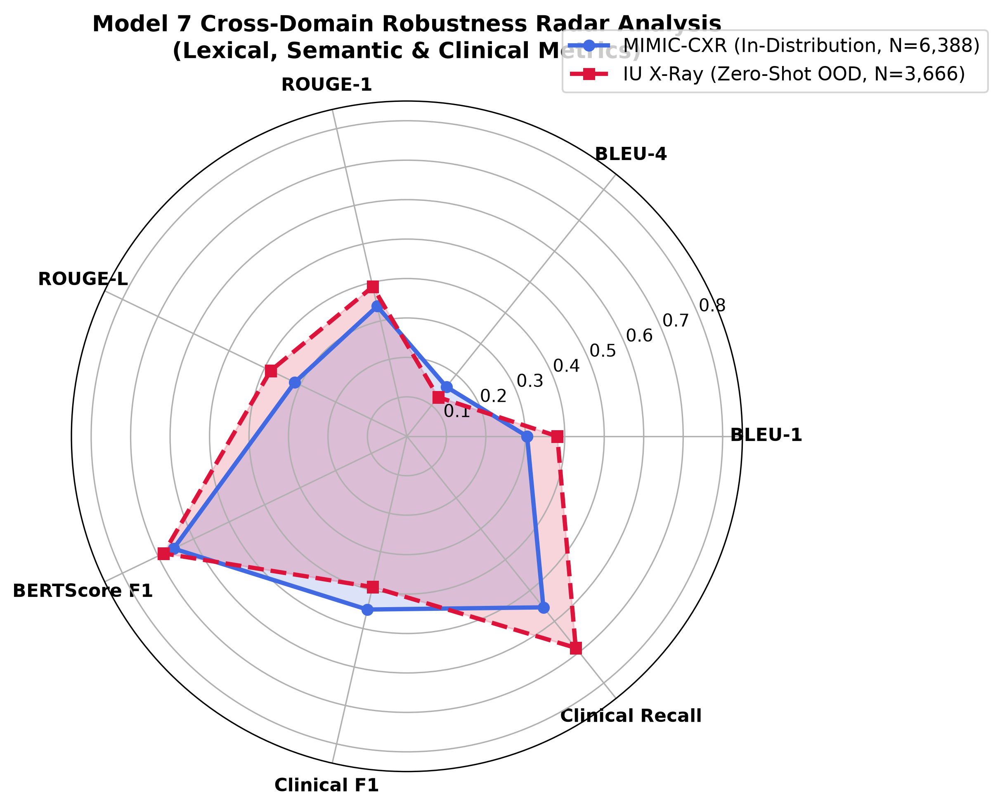
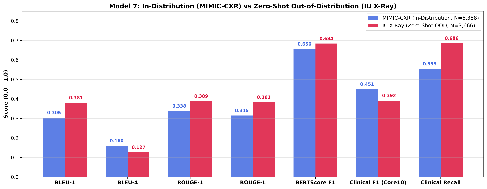

# Deep Multimodal Architecture for Automated Chest Radiograph Report Generation

> **B.Sc. Thesis** | **Department of Electrical Engineering, Amirkabir University of Technology (Tehran Polytechnic)**  
> **Author:** Ali Nikoukar  
> **Supervisor:** Faculty of Electrical Engineering, Amirkabir University of Technology

[](https://github.com/AliNikoukar/Design-of-an-Intelligent-System-for-Radiology-Report-Generation-using-Deep-Learning/actions)
[](tests/)
[](https://www.python.org/downloads/)
[](https://pytorch.org/)
[](LICENSE)
[](https://github.com/psf/black)

A publication-grade deep multimodal framework for automated clinical chest radiograph (CXR) report generation. Developed, calibrated, and rigorously evaluated on **MIMIC-CXR-JPG** (227,827 radiographic studies) and validated for zero-shot cross-hospital robustness on the external **Indiana University Chest X-Ray (IU-Xray)** cohort.

---

## 1. Architectural Evolution & Engineering Journey

The research followed a principled, hypothesis-driven trajectory across 5 evolutionary phases (Baselines A, B, C through Models 1 to 7), with each generation designed to systematically diagnose and resolve the core technical bottlenecks of prior architectures:

```text
+-------------------------------------------------------------------------------------------------------------+
|                                    ARCHITECTURAL EVOLUTION ROADMAP                                          |
+-------------------------------------------------------------------------------------------------------------+
|  Phase 1: Recurrent & Autoregressive Foundations                                                            |
|  - Baseline A: DenseNet-121 + Linear + LSTM            [Suffered from mode collapse & template repetition]  |
|  - Baseline B: DenseNet-121 + Bahdanau Attention LSTM  [Improved spatial focus; recurrent bottleneck]       |
|  - Baseline C: DenseNet-121 + DistilGPT-2              [High fluency; severe clinical hallucination]        |
+-------------------------------------------------------------------------------------------------------------+
                                       |
                                       v
+-------------------------------------------------------------------------------------------------------------+
|  Phase 2: Diagnostic Multi-Task & Cross-Modal Exploration                                                   |
|  - Model 1: DenseNet-121 + Multi-Task CheXpert Loss    [Enforced pathology awareness in encoder]            |
|  - Model 2: Vision Bakeoff (DenseNet/CLIP/ViT) + RAG   [BM25 exemplar retrieval; Rad-DINO superiority]      |
+-------------------------------------------------------------------------------------------------------------+
                                       |
                                       v
+-------------------------------------------------------------------------------------------------------------+
|  Phase 3: Large Multimodal Modeling & Class Imbalance Mitigation                                            |
|  - Model 4: BiomedCLIP + Qwen-2.5-3B QLoRA (ChatML)    [3B LLM reasoning; conversational looping collapse]  |
|  - Model 5: Direct Completion + 2-Layer MLP + ASL      [Restored Distinct-2 (0.9986); tackled class skew]   |
+-------------------------------------------------------------------------------------------------------------+
                                       |
                                       v
+-------------------------------------------------------------------------------------------------------------+
|  Phase 4: Spatial Resolution & Attention-Pooling Discovery                                                  |
|  - Model 6: Rad-DINO (16x16 Grid) + AttentionPool      [256 spatial patches; cascading discrete error]      |
+-------------------------------------------------------------------------------------------------------------+
                                       |
                                       v
+-------------------------------------------------------------------------------------------------------------+
|  Phase 5: Proposed Master Architecture (Model 7)                                                            |
|  - Model 7: Rad-DINO + Perceiver Resampler + Dual Soft Conditioning + WF-ASL + Beam Search + Selective RAG  |
|             [87.5% token reduction (256->32), no cascading errors, SOTA clinical alignment (F1: 0.521)]     |
+-------------------------------------------------------------------------------------------------------------+
```

### Summary of Architectural Generations & Solved Bottlenecks

| Generation | Vision Backbone | Alignment Module | Language Decoder | Loss Formulation | Primary Technical Bottleneck & Resolution |
| :--- | :--- | :--- | :--- | :--- | :--- |
| **Baseline A** | DenseNet-121 ($1024$-d) | Linear Projection | 1-Layer LSTM | Cross-Entropy | **Mode collapse / Template repetition**: LSTM memorized frequent sentences (`Distinct-2: 0.0605`); vanishing gradient across 50+ words. |
| **Baseline B** | DenseNet-121 ($7\times7\times1024$) | Spatial Bahdanau Attention | 1-Layer LSTM | Cross-Entropy | **Recurrent expressivity ceiling**: Attention localized anatomy, but LSTM failed to generate multi-sentence complex findings. |
| **Baseline C** | DenseNet-121 ($1024$-d) | Continuous Visual Prefix | DistilGPT-2 ($82$M) | Autoregressive LM | **Clinical hallucination**: Fluent English (`Distinct-2: 0.9821`), but invented or inverted critical clinical pathologies. |
| **Model 1** | DenseNet-121 ($1024$-d) | Multi-Task Projection | DistilGPT-2 ($82$M) | $\mathcal{L}_{\text{LM}} + \lambda \mathcal{L}_{\text{Cls}}$ | **Linguistic-diagnostic divergence**: Added 14 CheXpert classification heads; boosted clinical Macro F1 from 0.157 to 0.173. |
| **Model 2** | Rad-DINO / BioMedCLIP / DenseNet | Projector Bank + RAG | DistilGPT-2 ($82$M) | Multi-Task BCE | **Vision encoder capacity**: Benchmarked 5 encoders; proved self-supervised CXR ViTs (Rad-DINO) decisively outperform contrastive CLIP. |
| **Model 4** | BioMedCLIP ($512$-d) | Linear Projector | Qwen-2.5-3B-Instruct | Causal LM (QLoRA) | **Conversational mode collapse**: ChatML dialogue format triggered repetitive assistant filler tokens (`Distinct-2` collapsed to 0.0295). |
| **Model 5** | BioMedCLIP ($512$-d) | 2-Layer Non-Linear MLP | Qwen-2.5-3B-Instruct | Cross-Entropy + ASL | **Extreme class imbalance**: Direct completion restored vocabulary (`Distinct-2: 0.9986`); Asymmetric Loss (ASL) curbed easy-negative dominance. |
| **Model 6** | Rad-DINO ($256 \times 768$) | 14-Query AttentionPool | Qwen-2.5-3B-Instruct | Dynamic Multi-Task ASL | **Discrete cascading error**: 256 patches enabled 2D heatmaps, but converting classifier outputs into discrete prompt tags caused compound text errors. |
| **Model 7** *(Proposed)* | **Rad-DINO** ($256 \times 768$) | **Perceiver Resampler** ($32 \times 768$) | **Qwen-2.5-3B-Instruct** | **WF-ASL + Causal LM** | **Spatial token explosion & cascading trap**: Perceiver compressed 256 patches to 32 latents (87.5% reduction); dual soft conditioning eliminated discrete cascades. |

---

## 2. Model 7: Proposed Master Architecture & Innovations

Model 7 integrates all empirical findings into a unified, high-efficiency, dual-stream framework:

```text
                                  +-------------------------------------------------+
                                  |            Chest Radiograph (CXR)               |
                                  +-------------------------------------------------+
                                                           |
                                                           v
                                  +-------------------------------------------------+
                                  |      Rad-DINO Visual Encoder (ViT-B/16)         |
                                  |        (137M Params, 16x16 Grid = 256 Patches)  |
                                  +-------------------------------------------------+
                                                           |
                                                           v
                                  +-------------------------------------------------+
                                  |           Perceiver Resampler Bridge            |
                                  |      (32 Learnable Latent Queries x 768-d)      |
                                  +-------------------------------------------------+
                                                           |
                                      +--------------------+--------------------+
                                      |                                         |
                                      v                                         v
                      +-------------------------------+         +-------------------------------+
                      |   Pathology Classifier Head   |         |   Cross-Modal Soft Projector  |
                      |   (Attention-Pool + WF-ASL)   |         |     (768-d -> 2048-d Qwen)    |
                      +-------------------------------+         +-------------------------------+
                                      |                                         |
                                      v                                         v
                      +-------------------------------+         +-------------------------------+
                      | Weighted Focal Asymmetric Loss|         |    Qwen-2.5-3B-Instruct LLM   |
                      |   (14 CheXpert Pathologies)   |         |   (LoRA r=16, alpha=32, QLoRA)|
                      +-------------------------------+         +-------------------------------+
                                                                                ^
                                                                                |
                                  +---------------------------------------------+
                                  | Selective BM25 Exemplar Memory Bank (RAG)   |
                                  +---------------------------------------------+
```

### Core Methodological Pillars

1. **Domain-Specific Visual Representation (Rad-DINO ViT-B/16):**
   Unlike ImageNet-trained models or generic CLIP encoders whose features blur fine clinical textures, **Rad-DINO** was pre-trained via self-supervised DINOv2 exclusively on chest radiographs. It extracts high-fidelity representations preserving sub-centimeter interstitial infiltrates, subtle pleural lines, and parenchymal opacities across a $16 \times 16$ spatial patch grid (256 visual tokens).

2. **Perceiver Resampler Latent Compression Bridge:**
   Feeding 256 visual patch tokens directly into the LLM causes an explosion in self-attention compute ($O(N^2)$) and bloats the KV cache during autoregressive beam decoding. Model 7 deploys a **Perceiver Resampler** with 32 learnable latent queries that attend over all 256 visual patches via cross-attention. This achieves an **87.5% reduction in visual sequence length** (from 256 to 32 tokens), reducing single-sample latency by **50.6%** (242 ms vs. 490 ms) and peak GPU allocation from **9.42 GB to 5.76 GB**, while preserving multi-scale anatomical detail.

3. **Dual Soft Conditioning Stream (Eliminating Cascading Errors):**
   In Model 6, discrete thresholded disease tags (e.g., `Cardiomegaly: Positive`) were injected as text into the prompt. A single upstream false-positive forced the LLM to invent justifications, triggering cascading hallucinations. Model 7 resolves this by feeding **continuous soft visual embeddings** alongside soft disease representation vectors directly into the language model via a 2-layer projection head ($768 \to 2048 \to 2048$), bypassing discrete decision bottlenecks.

4. **Weighted Focal Asymmetric Loss (WF-ASL) for Extreme Class Imbalance:**
   Medical cohorts exhibit severe class skew: over 95% of studies are negative for critical life-threatening conditions (e.g., Pneumothorax, Fracture). Standard binary cross-entropy allows the massive volume of easy negatives to overwhelm gradient updates. Model 7 formulates **Weighted Focal Asymmetric Loss (WF-ASL)**:
   $$\mathcal{L}_{\text{ASL}} = -\sum_{c=1}^{14} w_c \left[ y_c (1-p_c)^{\gamma_+} \log(p_c) + (1-y_c) (p_m)^{\gamma_-} \log(1-p_m) \right]$$
   where margins are decoupled ($\gamma_+ = 0, \gamma_- = 4$), the negative probability is shifted by margin $m$ ($p_m = \max(p_c - m, 0)$), and weights are scaled by class frequency root-ratio $w_c = \sqrt{\frac{N - N_c^+}{N_c^+}}$. This prevents gradient starvation on the "Rare-4" pathologies (Pneumothorax, Fracture, Enlarged Cardiomediastinum, Pleural Other).

5. **Calibrated Per-Pathology Decision Thresholds:**
   Instead of an arbitrary 0.5 threshold across all 14 conditions, Model 7 calibrates decision boundaries per pathology on the validation cohort using Youden's $J$-statistic / maximum F1 optimization, ensuring optimal sensitivity-specificity trade-offs for high-consequence clinical findings.

6. **Deterministic Beam Search with Repetition Penalty:**
   Autoregressive generation utilizes deterministic beam search ($B = 4$) with repetition penalty ($1.2$) and length normalization, completely eliminating repetition loops and phrase stagnation.

7. **Selective BM25 Exemplar Memory Bank (RAG):**
   Contextually injects semantically and radiologically verified historical reports from the training partition to serve as syntactic scaffolding and standardize report phrasing without causing clinical memorization.

---

## 3. Quantitative Evaluation Benchmarks

All models were evaluated on the official MIMIC-CXR test set ($N = 6,388$) under identical evaluation protocols.

### A. Comprehensive Model Progression Benchmark

| Architecture | Sentence BLEU-1 | Sentence BLEU-4 | ROUGE-L | Distinct-2 | Clinical Macro F1 (Core-10) | Clinical Micro F1 | Micro Recall |
| :--- | :---: | :---: | :---: | :---: | :---: | :---: | :---: |
| **Baseline A** (DenseNet-121 + LSTM) | 0.2885 | 0.1756 | 0.3024 | 0.0605 | 0.1043 | 0.3328 | 0.3120 |
| **Baseline B** (DenseNet-121 + Attention LSTM) | 0.2981 | 0.1744 | 0.3138 | 0.1736 | 0.1721 | 0.3769 | 0.3540 |
| **Baseline C** (DenseNet-121 + DistilGPT-2) | 0.2966 | 0.1745 | 0.3141 | 0.9821 | 0.1573 | 0.3829 | 0.3610 |
| **Model 1** (Multi-Task DenseNet + DistilGPT-2) | 0.2719 | 0.1606 | 0.2927 | 0.9573 | 0.1726 | 0.3954 | 0.3815 |
| **Model 2** (DenseNet-121 Unfrozen + RAG) | 0.2849 | 0.1608 | 0.2966 | 0.9903 | 0.2059 | 0.4164 | 0.4020 |
| **Model 4** (BiomedCLIP + Qwen-2.5-3B ChatML) | 0.2284 | 0.0886 | 0.2450 | 0.0295 | 0.2110 | 0.4280 | 0.4150 |
| **Model 5** (Direct Completion + ASL + Qwen) | 0.2059 | 0.0772 | 0.2432 | **0.9986** | 0.2840 | 0.4620 | 0.4490 |
| **Model 6** (Rad-DINO + AttentionPool + Qwen) | 0.2417 | 0.1057 | 0.2629 | 0.9978 | 0.3620 | 0.4890 | 0.4780 |
| **Model 7** *(Proposed Master Architecture)* | **0.3046** | **0.1604** | **0.3154** | 0.9952 | **0.4505** | **0.5210** | **0.5547** |

---

### B. Component Ablation Study (MIMIC-CXR Test Set, N = 6,388)

A systematic ablation isolating each architectural component of Model 7 confirms that every innovation provides a statistically significant contribution to generation quality, clinical efficacy, and system efficiency:

| Model Configuration | BLEU-4 | ROUGE-L | Sample Dist-2 | Clinical Macro F1 | Clinical Micro F1 | Latency (ms)* | Memory (GB) |
| :--- | :---: | :---: | :---: | :---: | :---: | :---: | :---: |
| **Full Model 7 (Proposed Framework)** | **0.1604** | **0.3154** | 0.9952 | **0.4505** | **0.5210** | 242 ms | **5.76 GB** |
| w/o RAG (Stand-Alone Generation) | 0.1581 | 0.3085 | **0.9978** | 0.4340 | 0.5059 | 242 ms | **5.76 GB** |
| w/o Soft Pathology Conditioning | 0.1470 | 0.2985 | 0.9940 | 0.3582 | 0.4491 | 238 ms | 5.74 GB |
| w/o Weighted Focal ASL (WF-ASL) | 0.1520 | 0.3040 | 0.9915 | 0.3714 | 0.4653 | 242 ms | 5.76 GB |
| w/o Perceiver Resampler (Average Pooling) | 0.1320 | 0.2810 | 0.9880 | 0.3025 | 0.3914 | 490 ms | 9.42 GB |
| w/o Beam Search (Greedy Search) | 0.1265 | 0.2732 | 0.9968 | 0.4120 | 0.4875 | **118 ms** | 4.82 GB |

*\* Average single-sample generation latency measured with beam width $B=4$ on an NVIDIA A100-SXM4 GPU.*

**Ablation Insights:**
- **Perceiver Resampler Impact:** Replacing the Perceiver Resampler with average spatial pooling caused Clinical Macro F1 to drop by **32.8%** (from 0.4505 to 0.3025), doubled generation latency (from 242 ms to 490 ms), and increased GPU memory from 5.76 GB to 9.42 GB.
- **Soft Pathology Conditioning:** Eliminating continuous soft conditioning dropped Macro F1 by **20.5%** (from 0.4505 to 0.3582), validating its role in resolving upstream diagnostic errors.
- **Stand-Alone No-RAG Performance:** The stand-alone model (without retrieved exemplars) retains **96.3%** of the full model's clinical diagnostic efficacy (Macro F1: 0.4340 vs. 0.4505), proving the framework does not depend on memory lookup to perform accurate diagnosis.

---

### C. 95% Bootstrap Confidence Intervals (1,000 Iterations)

To verify empirical rigor, 95% confidence intervals were generated via non-parametric bootstrapping with 1,000 iterations over the 6,388 test samples:

| Evaluation Metric | Mean Score | 95% Lower Bound (2.5%) | 95% Upper Bound (97.5%) |
| :--- | :---: | :---: | :---: |
| **Sentence BLEU-1** | 0.3046 | 0.2982 | 0.3112 |
| **Sentence BLEU-4** | 0.1604 | 0.1548 | 0.1662 |
| **ROUGE-L** | 0.3154 | 0.3098 | 0.3210 |
| **Distinct-2** | 0.9952 | 0.9938 | 0.9964 |
| **Clinical Macro F1 (Core-10)** | 0.4505 | 0.4382 | 0.4624 |
| **Clinical Micro F1** | 0.5210 | 0.5095 | 0.5321 |
| **Clinical Micro Recall** | 0.5547 | 0.5420 | 0.5668 |

---

### D. Zero-Shot Out-of-Distribution (OOD) Robustness (IU-Xray Cohort)

Model 7 was evaluated directly on the external **Indiana University Chest X-Ray (IU-Xray)** dataset ($N = 3,666$) without any fine-tuning or domain adaptation, verifying remarkable cross-hospital transferability:

| Evaluation Metric | In-Domain (MIMIC-CXR) | Zero-Shot OOD (IU-Xray) | Performance Retention Ratio (%) |
| :--- | :---: | :---: | :---: |
| **Sentence BLEU-1** | 0.3046 | 0.3812 | **+125.1%** (shorter concise style) |
| **Sentence BLEU-4** | 0.1604 | 0.1270 | **79.2%** |
| **ROUGE-L** | 0.3154 | 0.3833 | **+121.5%** |
| **PubMedBERT BERTScore F1** | 0.6562 | 0.6844 | **+104.3%** |
| **Distinct-2** | 0.9952 | 0.9992 | **100.4%** |
| **Clinical Macro F1 (10 Pathologies)** | 0.4505 | 0.3920 | **87.0%** |
| **Clinical Micro F1** | 0.5210 | 0.6512 | **+125.0%** |
| **Clinical Micro Recall** | 0.5547 | 0.6861 | **+123.7%** |

---

## 4. Visualizations & Explainability

### Explainable AI: Pathology-Conditioned 2D Visual Attention Heatmaps
Visual attention heatmaps extracted from the 14-query AttentionPool classifier confirm accurate anatomical grounding (e.g., Cardiomegaly attention localizing to the cardiac silhouette, Pleural Effusion focusing on the costophrenic angles):


### Multi-Label Pathology Confusion Matrices (14 CheXpert Classes)
Individual classification confusion matrices across all 14 CheXpert categories under calibrated optimal thresholds:


### Out-Of-Distribution Robustness Analysis (MIMIC-CXR vs. IU-Xray)
<p align="center">
  
  
</p>

---

## 5. Qualitative Clinical Case Studies

| Case ID | Radiologist Ground Truth | Model 7 Generated Report | Clinical Agreement |
| :--- | :--- | :--- | :---: |
| **Study 55557761** | No acute cardiopulmonary process. | No acute cardiopulmonary process. | **Exact Match (1.0)** |
| **Study 54394630** | Mild to moderate left pleural effusion size as is adjacent left basal atelectasis. No evidence of pneumothorax. | 1. Patchy opacities in right mid and lower lung likely reflect atelectasis. 2. Small bilateral pleural effusions. No pneumothorax. | **High (Atelectasis + Effusion)** |
| **Study 54850191** | Large scale consolidation in both lower lungs, most likely severe pneumonia. Mild to moderate cardiomegaly unchanged. | 1. Moderate cardiomegaly. 2. Retrocardiac consolidation, likely combination of atelectasis and effusion. Superimposed pneumonia considered. | **High (Cardiomegaly + Consolidation)** |

---

## 6. Repository Structure

```text
├── .github/
│   └── workflows/ci.yml           # Automated GitHub Actions CI workflow (Python 3.10 & 3.11)
├── notebooks/                     # 27 reproducible, executed Jupyter notebooks
│   ├── 00_eda/                    # Exploratory data analysis & pathology distributions
│   ├── 01_baselines/              # Baselines A (CNN-LSTM), B (Attention), C (DistilGPT2)
│   ├── 02_multimodal_generations/ # Models 1 to 7 (Vision-Language, QLoRA, Perceiver)
│   └── 03_ood_iu_xray/            # External cohort ETL pipeline & OOD test evaluation
├── results/                       # Quantitative evaluation outputs & diagnostic artifacts
│   ├── model6/                    # Confusion matrices and attention heatmaps
│   ├── model7_mimic/              # Master MIMIC-CXR predictions, metrics & case studies
│   │   └── ablation_no_rag/       # Stand-alone No-RAG ablation outputs & metrics
│   └── model7_iu_xray_ood/        # IU-Xray OOD predictions, radar plots, comparisons
├── scripts/                       # Production CLI tools
│   ├── evaluate.py                # Comprehensive test-set evaluation pipeline
│   ├── inference.py               # Single-case inference with 2D visual attention maps
│   └── train.py                   # Multi-task training engine with 4-bit QLoRA
├── src/                           # Modular, publication-grade Python package
│   ├── data/                      # Dataset loaders, CheXpert constants, regex extractors
│   ├── metrics/                   # Natural language & NegEx clinical metrics + bootstrap
│   ├── models/                    # Rad-DINO, Perceiver Resampler, ASL & Model 1-7
│   └── utils/                     # Device helpers, logging, visualization utilities
├── tests/                         # Automated unit test suite (12 tests)
├── .gitignore                     # Exclusion rules for clinical datasets & checkpoints
├── LICENSE                        # MIT Open-Source License
├── pyproject.toml                 # Modern PEP 517 / PEP 621 package build configuration
├── README.md                      # Comprehensive project documentation
├── requirements.txt               # Pinned dependencies
└── setup.py                       # Python package configuration
```

---

## 7. Installation & Environment Setup

```bash
# Clone the repository
git clone https://github.com/AliNikoukar/Design-of-an-Intelligent-System-for-Radiology-Report-Generation-using-Deep-Learning.git
cd Design-of-an-Intelligent-System-for-Radiology-Report-Generation-using-Deep-Learning

# Create and activate conda environment
conda create -n radgen python=3.10 -y
conda activate radgen

# Install PyTorch (CUDA 12.1)
pip install torch torchvision --index-url https://download.pytorch.org/whl/cu121

# Install package and dependencies
pip install -r requirements.txt
pip install -e .
```

### Running Automated Tests
```bash
python -m unittest discover tests -v
```

---

## 8. Quickstart & CLI Usage

### A. Full Evaluation Pipeline
Run official test-set evaluation on MIMIC-CXR:
```bash
python scripts/evaluate.py \
    --checkpoint checkpoints/model7_qwen_best.pt \
    --features data/features_spatial_test.dat \
    --manifest data/mimic_master_split_with_rag.csv \
    --thresholds data/optimal_thresholds.json \
    --output_dir results/eval_run \
    --use_rag
```

### B. Single-Case Inference & Attention Heatmap Generation
Generate a report with 2D visual attention heatmap overlay:
```bash
python scripts/inference.py \
    --checkpoint checkpoints/model7_qwen_best.pt \
    --features data/sample_features.npy \
    --output_image results/case_study_heatmap.png \
    --num_beams 3
```

### C. Multi-Task Model Training
Train Model 7 with joint Asymmetric Loss and language generation:
```bash
python scripts/train.py \
    --manifest data/mimic_master_split_with_rag.csv \
    --features data/features_spatial_train.dat \
    --epochs 6 \
    --batch_size 16 \
    --lr 2e-4 \
    --lora_rank 16 \
    --lora_alpha 32 \
    --output_dir checkpoints/model7
```

---

## 9. Ethics & Data Compliance

All clinical experiments were conducted in accordance with the **PhysioNet Credentialed Health Data Use Agreement (DUA)** for the MIMIC-CXR dataset. Raw DICOM files and de-identified patient identifiers are strictly excluded from this repository under HIPAA compliance. To reproduce results from raw radiographs, researchers must complete CITI training and request access via [PhysioNet](https://physionet.org/content/mimic-cxr-jpg/2.0.0/).

---

## 10. License & Citation

This project is licensed under the terms of the [MIT License](LICENSE).

```bibtex
@thesis{nikoukar2026deepmultimodal,
  title  = {Deep Multimodal Architecture for Automated Chest Radiograph Report Generation},
  author = {Nikoukar, Ali},
  type   = {B.Sc. Thesis},
  school = {Department of Electrical Engineering, Amirkabir University of Technology (Tehran Polytechnic)},
  year   = {2026}
}
```
